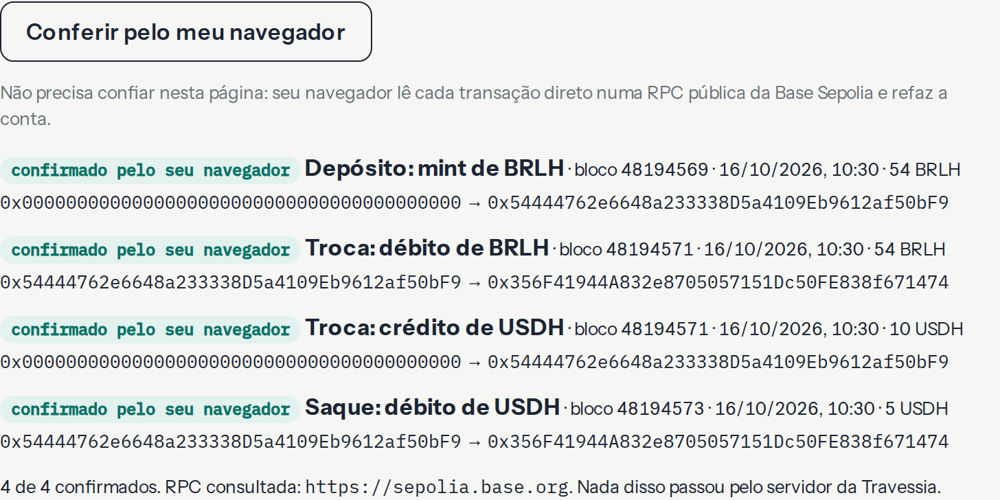
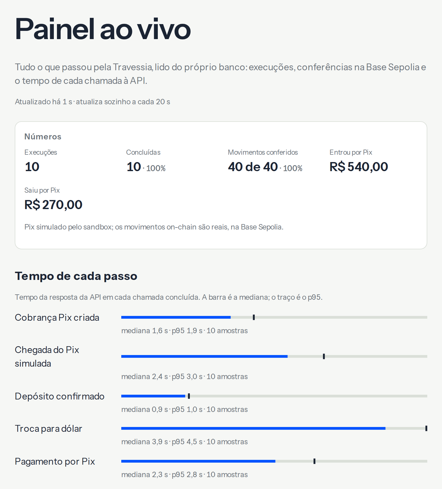
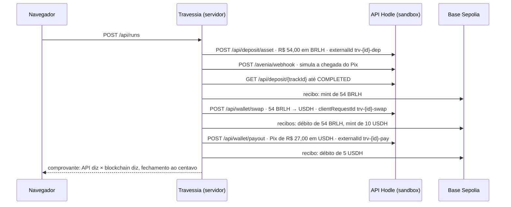

# Travessia

**Receba em Pix, guarde em dólar, pague em stablecoin.** Um ciclo completo executado ao vivo no sandbox da [Hodle](https://hodle.com.br), com cada movimento conferido direto na Base Sepolia.

**Demo: https://travessia-hodle.fly.dev** (abra no celular, leva 2 minutos) · **Painel: https://travessia-hodle.fly.dev/painel**

> Projeto independente e não oficial, construído sobre o sandbox público da API da Hodle. Nenhum dinheiro real se move.


## O que tem na demo

- **Um ciclo de verdade, em três atos.** Um botão, "Executar com R$ 54,00", e a Travessia faz tudo pela API:
  1. **Receba em Pix:** cobra R$ 54,00 por Pix (BR Code), simula a chegada do Pix e confirma o depósito. Na blockchain, aparecem 54 BRLH na carteira de teste.
  2. **Guarde em dólar:** troca os 54 BRLH por 10 USDH, no câmbio fixo do sandbox (1 USD = R$ 5,40).
  3. **Pague em stablecoin:** paga um Pix de R$ 27,00 usando 5 USDH.

  O visitante não digita nada: a chave Pix de destino é fixa e fictícia.
- **Comprovante "API diz × blockchain diz".** Cada um dos quatro movimentos on-chain aparece lado a lado: o valor que a API informou e o valor que a Base Sepolia registrou no evento `Transfer`. A conferência dá `confere`, `ainda não conferido` ou `diverge`, com o hash completo e o link do BaseScan.
- **Fechamento ao centavo.** `entrou = saiu por Pix + guardado + taxas`, calculado em inteiros a partir das respostas da API, não escrito no código.
- **Conferir pelo meu navegador.** O navegador de quem está vendo busca as quatro transações direto numa RPC pública da Base Sepolia e refaz a conta, sem passar pelo servidor da Travessia. Mostra bloco, horário, valor e origem → destino de cada movimento.

  
- **Prova de idempotência.** "Pagar de novo (mesma chave)" repete o saque com o mesmo `externalId` e compara as duas respostas: mesmo `transactionId`, mesmo `txHash`, nenhum pagamento novo.
- **Ver código em cada passo.** A requisição exatamente como foi enviada, em curl e em TypeScript, com a chave redigida, mais a resposta da API.
- **Link permanente, extrato e preview.** Cada execução tem o comprovante em `/r/{id}`, um extrato CSV e uma imagem de preview, para o link aparecer bem no WhatsApp.
- **Painel ao vivo.** O `/painel` mostra:
  - as execuções e o volume que passou pela API;
  - a taxa de movimentos `confere`;
  - o tempo de cada chamada à API (mediana e p95);
  - as últimas execuções e transações.

  Ele se atualiza sozinho a cada 20 s.

  
- **Servidor MCP.** Um agente de IA (Claude Code, Cursor, Codex) fecha o mesmo ciclo usando só ferramentas. Detalhes [abaixo](#servidor-mcp-para-agentes-de-ia).

## O que acontece quando você aperta o botão



O navegador chama `POST /api/runs/{id}/next` em sequência. Cada chamada executa um passo e devolve o estado completo, com as conferências, então a tela avança sem streaming. O ciclo inteiro costuma levar uns 15 segundos.

## Decisões de engenharia

- **Idempotência de verdade.** Cada passo de escrita tem uma chave derivada do id da execução (`trv-{id}-dep`, `-swap`, `-pay`), gravada no banco antes da chamada. A chave de um passo nunca muda: se ele precisar ser repetido, vai com a mesma chave.
- **Resultado incerto não é erro nem sucesso.** Timeout, queda de rede ou 5xx numa escrita viram `outcomeUnknown`. O passo fica "resultado incerto" e a próxima tentativa, depois de uma pequena espera, reenvia a mesma requisição com a mesma chave. `429` e `SANDBOX_SWAP_IN_PROGRESS` respeitam o `Retry-After`. Cada passo tem no máximo 4 tentativas.
- **Dinheiro em inteiros.** Centavos de real e unidades brutas de token (18 casas no BRLH, 6 no USDH) em `bigint`, com o truncamento do sandbox. Nenhum valor monetário passa por `number`.
- **Não confie, confira.** Para cada hash, o servidor lê o recibo na Base Sepolia, com viem e uma RPC pública de reserva, e decodifica o `Transfer` ERC-20. Depois compara token, origem, destino e valor com o que a API disse. Se a RPC demorar, a linha fica "ainda não conferido" e é conferida de novo quando alguém abre o comprovante.
- **Uma execução por vez.** A carteira de teste é compartilhada, então há uma trava global. O lease de 45 s conta a partir do fim do último passo e nunca vence com um passo em andamento. Se o visitante fecha a aba, a execução fica marcada como interrompida e a trava se libera.
- **Protegido contra abuso.** Os endpoints são públicos, então:
  - uma execução por vez;
  - teto diário de execuções (`DAILY_RUN_CAP`);
  - `KILL_SWITCH` para pausar tudo;
  - "Pagar de novo" limitado a 3 vezes por execução e a 10 por minuto no total, dentro da mesma trava;
  - a chave Pix de destino é fixa no servidor.
- **Webhooks prontos para produção.** A verificação HMAC é feita sobre o corpo cru, com janela de 5 min e comparação em tempo constante. Um livro de eventos deduplica e nunca regride o estado. Os dois foram testados com os payloads da documentação. O sandbox não entrega webhooks para fora, então a demo usa as respostas síncronas da API.
- **A chave fica no servidor.** A chave da API só existe em módulos `server-only`. Todo registro de requisição sai redigido (`Bearer [REDACTED]` no "ver código"). A varredura no CI falha o build se algo com formato de chave aparecer na saída. O app recusa chaves `hodle_live_`.

## Testes

| Camada | O que cobre |
| --- | --- |
| **Unitários** (163, Vitest, sem rede, no CI) | dinheiro e truncamento; client (erros, timeout, `outcomeUnknown`, redação de segredos ecoados); conferência on-chain com os recibos reais das sondagens; webhooks; banco; trava e lease; orquestrador contra um dublê do sandbox; painel |
| **E2E** (Playwright, desktop e celular) | ciclo completo pela interface com 4 `confere`; prova de idempotência; CSV; `/r/{id}`; imagens de preview; conferência pelo navegador numa RPC pública; painel; acessibilidade (axe) e ausência de rolagem horizontal |
| **Contrato** (`pnpm contract`) | ciclo real no sandbox conferindo cada resposta e cada transação on-chain |

O orquestrador tem um teste para cada cenário de falha que mais pode afetar quem usa:
- timeout no saque: o passo é repetido com a mesma chave e o pagamento não acontece duas vezes;
- saque recusado por saldo;
- `202` com `status: "FAILED"`;
- troca estornada (`422 SANDBOX_SWAP_REFUNDED`), com os hashes continuando visíveis;
- depósito que não confirma;
- `429`;
- dois cliques ao mesmo tempo;
- aba fechada no meio da execução;
- `next` depois do fim;
- "Pagar de novo" em paralelo e com kill switch;
- a chave nunca gravada no banco, nem quando a API a ecoa.

## Rodar localmente

Requisitos: Node 22 (`.nvmrc`) e pnpm via corepack. Crie uma chave `hodle_test_` em app-sandbox.hodle.com.br → APIs e webhooks → Ambientes: Sandbox.

```bash
corepack enable pnpm
pnpm install
cp .env.example apps/web/.env.local   # coloque sua chave hodle_test_ em HODLE_API_KEY
cp .env.example .env.sandbox          # usado por pnpm contract e pnpm mcp:smoke (mesma chave)
pnpm --filter @travessia/web dev      # http://localhost:3000
```

| Comando | O que faz |
| --- | --- |
| `pnpm test` | testes unitários, sem rede |
| `pnpm lint && pnpm typecheck` | lint e tipos |
| `pnpm contract` | ciclo real no sandbox conferido contra o que a Travessia espera e contra a blockchain |
| `BASE_URL=http://localhost:3000 pnpm e2e` | ciclo pela interface com Playwright, desktop e celular (executa de verdade no sandbox) |
| `pnpm mcp:smoke` | ciclo completo usando só as ferramentas do MCP, via stdio |

### Variáveis de ambiente

| Variável | Padrão | Para quê |
| --- | --- | --- |
| `HODLE_API_KEY` | (obrigatória) | chave `hodle_test_` do sandbox; chaves de produção são recusadas |
| `HODLE_API_URL` | `https://sandbox-api.hodle.com.br` | host da API |
| `PIX_KEY_DEMO` | `recebedor@example.com` | chave Pix fixa e fictícia do saque |
| `DAILY_RUN_CAP` | `200` | execuções por dia (UTC) |
| `KILL_SWITCH` | `false` | `true` pausa novas execuções e repetições |
| `BASE_SEPOLIA_RPC_URLS` | `https://sepolia.base.org,https://base-sepolia-rpc.publicnode.com` | RPCs usadas na conferência, em ordem de preferência |
| `DATABASE_PATH` | `/data/travessia.sqlite` | arquivo SQLite |
| `PUBLIC_BASE_URL` | `http://localhost:3000` | URL pública, usada nas imagens de preview |

## Deploy

Um container (Next.js standalone) no Fly.io, região `gru`, com uma máquina sempre ligada e um volume para o SQLite. A trava e o banco vivem no processo, então a demo roda numa instância só, de propósito.

```bash
fly apps create travessia-hodle
fly volumes create travessia_data --region gru --size 1
fly secrets import < .env.sandbox     # a chave vai do arquivo direto para o Fly
fly deploy --ha=false
```

O `.dockerignore` deixa de fora todo `.env*` (exceto o `.env.example`) e o material interno. A imagem final não contém a chave e roda como o usuário `node`.

## Estrutura

```
packages/hodle   núcleo reutilizável
  money/         dinheiro em bigint e câmbio do sandbox
  client/        chamadas tipadas com Zod, HodleError, timeouts, redação de segredos
  chain/         leitura de recibos e conferência de Transfer na Base Sepolia (viem)
  webhooks/      verificação HMAC e livro de eventos
apps/web         Next.js (App Router)
  lib/run/       orquestrador, trava, modelo do comprovante, CSV
  lib/store/     SQLite com node:sqlite (sem dependência nativa)
  app/           console, /r/{id}, /painel, rotas da API e imagens de preview
packages/mcp     servidor MCP para agentes de IA
scripts/         varredura de segredos, suíte de contrato, teste do MCP
```

## Servidor MCP para agentes de IA

`packages/mcp` é um servidor MCP (stdio) que segue o contrato publicado em [docs.hodle.com.br/docs/ai/mcp](https://docs.hodle.com.br/docs/ai/mcp):
- a chave entra só pelo ambiente;
- as ferramentas de escrita só são registradas com `HODLE_MCP_ALLOW_WRITES=true`;
- toda escrita exige `confirm: true`; sem ele, nada é enviado e a resposta descreve o que seria feito;
- PIN e chave protegida entram só pelo ambiente e são mascarados na saída;
- timeouts de 15 s para leitura e 60 s para escrita;
- `outcomeUnknown` vem com a instrução de conferir antes de repetir.

Ele traz as três ferramentas de que um agente precisa para fechar sozinho o ciclo do sandbox: consultar o depósito, simular a chegada do Pix e trocar de ativo.

| Ferramenta | Tipo | Chamada |
| --- | --- | --- |
| `hodle_wallet_get` | leitura | `GET /api/wallet` |
| `hodle_deposit_status` | leitura | `GET /api/deposit/{id}` |
| `hodle_deposit_asset` | escrita | `POST /api/deposit/asset` |
| `hodle_sandbox_settle` | escrita, só sandbox | `POST /avenia/webhook` |
| `hodle_wallet_swap` | escrita, só sandbox | `POST /api/wallet/swap` |
| `hodle_wallet_payout` | escrita | `POST /api/wallet/payout` (recusa `subAccountId`) |

```bash
claude mcp add travessia-hodle \
  -e HODLE_API_KEY=hodle_test_... \
  -e HODLE_MCP_ALLOW_WRITES=true \
  -- node /caminho/para/travessia/packages/mcp/bin/travessia-hodle-mcp.mjs
```

`pnpm mcp:smoke` fecha o ciclo usando só as ferramentas, pelo mesmo stdio que um agente usa:

```
travessia-hodle-mcp: sandbox, escrita ligada
ferramentas: hodle_wallet_get, hodle_deposit_status, hodle_deposit_asset, hodle_sandbox_settle, hodle_wallet_swap, hodle_wallet_payout
→ hodle_deposit_asset (recusado)
   confirm: true ausente: nada foi enviado.
→ hodle_deposit_asset
→ hodle_sandbox_settle
→ hodle_deposit_status
   depósito COMPLETED, mint 0xe30f9e4bca35cfb8dd4aae11fb85ae7f354d00a240623d6e9ec16f74a24e784c
→ hodle_wallet_swap
   troca 1.08 BRLH → 0.2 USDH
→ hodle_wallet_payout
   saque COMPLETED: 0.1 USDH, endToEndId SANDBOX06BBCB33CB324E91B95B4EDEF, tx 0xdc7277030620935a87effdb6e009da6a093808283b58b6205966b3a5a48ffa50
```

## Licença

MIT. Se for útil para a Hodle, é de vocês.
