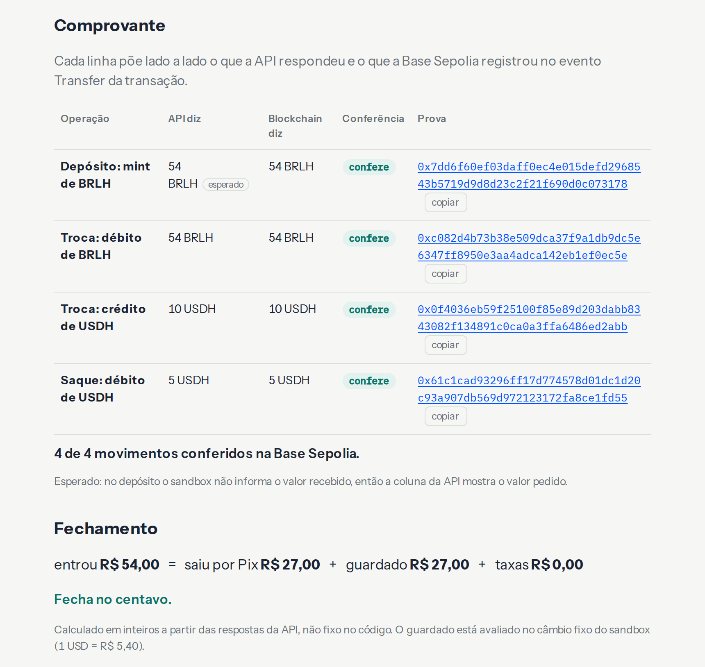
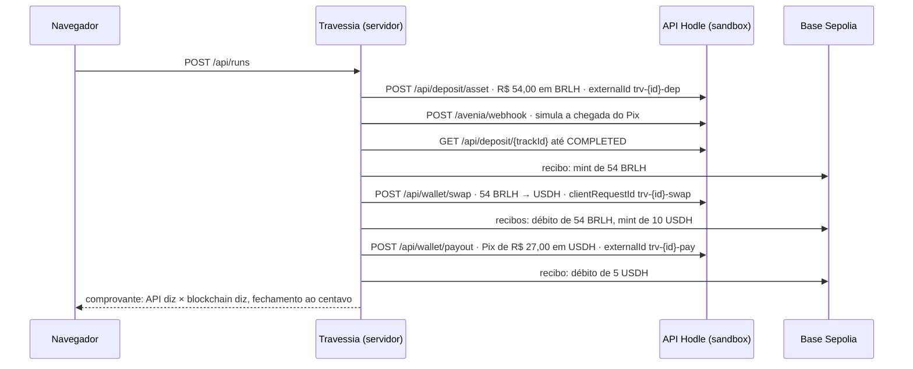

# Travessia

**Receba em Pix, guarde em dólar, pague em stablecoin.** Um ciclo completo executado ao vivo no sandbox da [Hodle](https://hodle.com.br), com cada movimento conferido direto na Base Sepolia.

**Demo: https://travessia-hodle.fly.dev** (abra no celular, leva 2 minutos)

> Projeto independente e não oficial, construído sobre o sandbox público da API da Hodle. Nenhum dinheiro real se move.



## O que acontece quando você aperta o botão



O navegador chama `next` em sequência; cada resposta traz o passo executado e as conferências. O comprovante fica em `/r/{id}`, com extrato CSV e imagem de preview.

## Decisões de engenharia

- **Idempotência de verdade.** Cada passo de escrita tem uma chave derivada do id da execução (`trv-{id}-dep`, `-swap`, `-pay`), gravada no banco antes da chamada. O botão "Pagar de novo" repete o saque com a mesma chave e mostra lado a lado: mesmo `transactionId`, mesmo `txHash`, nenhuma transação nova.
- **Resultado incerto não é erro nem sucesso.** Timeout, queda de rede ou 5xx numa escrita viram `outcomeUnknown`. O passo fica "resultado incerto" e a próxima tentativa reenvia a mesma requisição com a mesma chave. Nunca uma chave nova para o mesmo passo, nunca repetição às cegas.
- **Dinheiro em inteiros.** Centavos de real e unidades brutas de token (18 casas no BRLH, 6 no USDH) em `bigint`, com o truncamento do sandbox. O fechamento (`entrou = saiu por Pix + guardado + taxas`) é calculado das respostas da API, não escrito no código.
- **Não confie, confira.** Para cada hash, o servidor lê o recibo na Base Sepolia (viem, RPC público com reserva), decodifica o `Transfer` ERC-20 e compara token, origem, destino e valor com o que a API disse: `confere`, `ainda não conferido` ou `diverge`.
- **Uma execução por vez.** A carteira de teste é compartilhada, então há uma trava global. O lease de 45 s conta a partir do fim do último passo e nunca vence com um passo em andamento.
- **Webhooks prontos para produção.** Verificação HMAC sobre o corpo cru com janela de 5 min e comparação em tempo constante, e um livro de eventos que deduplica e nunca regride o estado, testados com os payloads da documentação. O sandbox não entrega webhooks para fora, então a demo usa as respostas síncronas da API.
- **A chave fica no servidor.** Módulos `server-only`, redação em todo registro de requisição (`Bearer [REDACTED]` no "ver código") e varredura no CI que falha o build se algo com formato de chave aparecer na saída.

## O que o sandbox não prova

Pix de verdade (o BR Code não é pagável e o `endToEndId` é `SANDBOX…`), Lightning, falhas e estornos (`PAYOUT_FAILED`, `PAYOUT_REFUNDED`, `DEPOSIT_ASSET_REFUNDED`), MED, entrega de webhooks e câmbio de mercado (o sandbox usa 1 USD = R$ 5,40 fixo).

## Rodar localmente

Requisitos: Node 22 (`.nvmrc`) e pnpm via corepack. Crie uma chave `hodle_test_` em app-sandbox.hodle.com.br → APIs e webhooks → Ambientes: Sandbox.

```bash
corepack enable pnpm
pnpm install
cp .env.example apps/web/.env.local   # e coloque sua chave hodle_test_
pnpm --filter @travessia/web dev      # http://localhost:3000
```

| Comando | O que faz |
| --- | --- |
| `pnpm test` | testes unitários, sem rede (roda no CI) |
| `pnpm lint && pnpm typecheck` | lint e tipos (roda no CI) |
| `pnpm contract` | ciclo real no sandbox conferido contra a documentação e a blockchain (lê `.env.sandbox`) |
| `BASE_URL=http://localhost:3000 pnpm e2e` | ciclo pela interface com Playwright, desktop e celular, com checagem de acessibilidade |

## Estrutura

```
packages/hodle   núcleo: dinheiro em bigint, client tipado com HodleError, conferência on-chain, webhooks
apps/web         Next.js: orquestrador com trava, SQLite (node:sqlite), rotas e interface
packages/mcp     servidor MCP para agentes de IA
```

## Licença

MIT. Se for útil para a Hodle, é de vocês.
